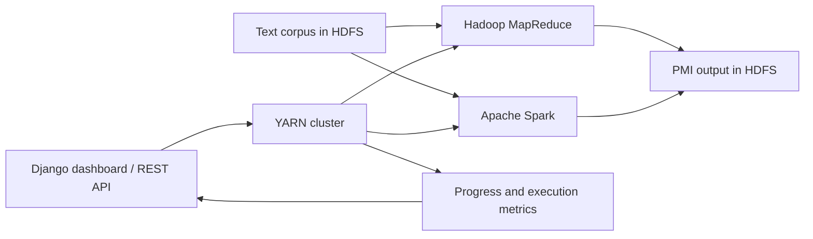

# Distributed Co-occurrence & PMI

**The same text-analysis pipeline, implemented with Hadoop MapReduce and Apache Spark.**

Cloud Computing project · University of Pisa · 2025–2026

Count words, discover which words occur together, and compute their association scores over a text corpus. A Django dashboard submits jobs to YARN, tracks progress across pipeline stages, and compares execution time, memory metrics and throughput between the two engines.

## Overview

| Component | What it does |
|---|---|
| **Hadoop / Java** | Three sequential MapReduce jobs, with the Stripes approach for co-occurrence counting and DistributedCache for word frequencies. |
| **Spark / Python** | An RDD pipeline with partition-local aggregation, cached input and broadcast word frequencies. Only the final scores are written to HDFS. |
| **Django / REST API** | Job submission, persisted lifecycle and parameters, YARN monitoring, and a browser dashboard. |
| **Comparison dashboard** | Side-by-side inspection of completed Hadoop and Spark runs across dataset sizes, context windows and reducer/partition counts. |



## The computation

Both implementations lowercase each line, replace characters outside `a–z` and whitespace with spaces, and split the result into tokens. Co-occurrences use a symmetric context window of `k` tokens on each side, excluding the center position. Windows stay within a line; pairs are directed.

The three stages are:

1. **Word count:** compute each token frequency `c(x)` and the total token count `N`.
2. **Co-occurrence count:** compute `c(x, y)` for neighboring tokens.
3. **PMI:** compute `log2(c(x, y) × N / (c(x) × c(y)))` and retain pairs whose score is at least zero.

This is the counting convention used by the code. Negative-score pairs are omitted rather than written with a zero value. Final output is tab-separated text:

```text
word_x<TAB>word_y<TAB>score
```

Hadoop writes `word_counts/`, `co_occurrence/` and `pmi_output/`. Spark keeps intermediate RDDs in memory or on disk and writes `pmi_output/` only. Both load the complete unigram vocabulary into memory for the final join, so vocabulary size remains a scaling constraint.

## Repository layout

```text
cooccurrence-pmi/   Java MapReduce pipeline and Maven build
spark-pmi/         PySpark entry point and pipeline stages
webserver/         Django API, job runner, YARN monitor and dashboards
utils/             Corpus-size preparation script
datasets/          Local dataset directory; corpus files are not tracked
```

## Requirements

- An HDFS and YARN cluster, with client configuration available on the submission machine.
- Hadoop **3.3.6**, as declared in the Maven build.
- Maven and a JDK; the Java project targets **Java 8** bytecode. Use a JDK supported by your Hadoop and Spark installations.
- Apache Spark with PySpark, configured for the same cluster.
- Python **3.10+** for the web application. Match the Python version on Spark submission and executor machines.

Cluster provisioning is external to this repository. Docker definitions, dependency lockfiles and benchmark result datasets are not included.

## 1. Prepare a corpus

The original dataset reference is [Refined BookCorpus on Kaggle](https://www.kaggle.com/datasets/nishantsingh96/refined-bookcorpus-dataset). Download it separately and follow its access and usage conditions.

The pipelines consume **plain text**, not parsed CSV records. Prepare one text segment per line; extract the text column first if your source is a structured CSV.

To create the experiment subsets, `utils/get_datasets_sizes.py` reads `datasets/bookcorpus.csv` relative to the `utils/` working directory and writes approximately 0.5, 1.0 and 1.5 GiB text files there:

```bash
cd utils
python get_datasets_sizes.py
cd ..
```

That helper copies complete lines; it does not parse CSV columns. Inspect or preprocess its input accordingly. Upload the prepared text to HDFS:

```bash
hdfs dfs -mkdir -p /input/corpus
hdfs dfs -put /path/to/corpus.txt /input/corpus/
```

## 2. Run the pipelines directly

### Hadoop

Build from the repository root:

```bash
mvn -f cooccurrence-pmi/pom.xml clean package
hadoop jar cooccurrence-pmi/target/cooccurrence-pmi.jar \
  hdfs:///input/corpus hdfs:///output/hadoop-run-001 2 2
```

Arguments: `<input> <output_base> [window_size] [num_reducers]`. Defaults are `2` and `2`. Word count always uses one reducer; the reducer argument controls the second and third jobs.

### Spark

Package the shared Python module so YARN executors can import it:

```bash
cd spark-pmi
python -m zipfile -c /tmp/cloud-pmi.zip pmi
spark-submit --master yarn --deploy-mode cluster \
  --py-files /tmp/cloud-pmi.zip \
  main.py hdfs:///input/corpus hdfs:///output/spark-run-001 2 2
cd ..
```

Arguments: `<input> <output_base> [window_size] [partitions]`. Defaults are `2` and `2`.

Use a fresh output directory for each run: Hadoop and Spark expect their output paths not to exist. Read the final results with:

```bash
hdfs dfs -cat '/output/hadoop-run-001/pmi_output/part-*'
hdfs dfs -cat '/output/spark-run-001/pmi_output/part-*'
```

## 3. Start the dashboard

Create a Python environment and install the web application's imported dependencies. These are setup dependencies, not a locked reproduction of the original cluster:

```bash
python3 -m venv .venv
source .venv/bin/activate
python -m pip install 'Django>=5.2,<6' djangorestframework dj-database-url requests
```

Configure the current shell from the repository root:

```bash
export SECRET_KEY="$(python -c 'import secrets; print(secrets.token_urlsafe(64))')"
export DATABASE_URL="sqlite:///$PWD/webserver/db.sqlite3"
export DEBUG=True
export YARN_RM_URL=http://localhost:8088
export HADOOP_HOME=/opt/hadoop
export HADOOP_JAR_PATH="$PWD/cooccurrence-pmi/target/cooccurrence-pmi.jar"
export SPARK_HOME=/opt/spark
export SPARK_PMI_DIR="$PWD/spark-pmi"
export HDFS_OUTPUT_BASE=hdfs:///output

cd webserver
python manage.py makemigrations jobs
python manage.py migrate
python manage.py runserver --noreload
```

Replace installation paths and the ResourceManager URL with your cluster's values. Export the same application settings in each shell that runs a management command. Settings read environment variables directly; `.env` files are not loaded automatically. `SECRET_KEY` is required and should be stored securely and reused for a persistent deployment.

Initial `jobs` migrations are currently ignored by Git, so generate them before the first database migration. SQLite is suitable for local exploration; for a shared deployment, configure `DATABASE_URL` for your database and install its Python driver separately.

Open [the local dashboard](http://127.0.0.1:8000/) or [the comparison page](http://127.0.0.1:8000/compare/). In another configured shell, keep YARN status synchronized:

```bash
cd webserver
python manage.py poll_jobs --interval 5
```

The web runner submits background threads. `--noreload` avoids development-server reloads interrupting them. The Spark runner's executor and speculation settings are defined in `webserver/jobs/spark_service.py`; adapt them to the cluster's resource limits.

## REST API

| Method | Endpoint | Purpose |
|---|---|---|
| `GET`, `POST` | `/api/jobs/` | List jobs or submit a new pipeline |
| `GET` | `/api/jobs/<id>/` | Full job details |
| `GET` | `/api/jobs/<id>/status/` | Status and live progress |
| `GET` | `/api/jobs/status/<status>/` | Filter by `submitted`, `running`, `completed` or `failed` |
| `GET` | `/api/jobs/compare/` | Completed jobs for comparison |

For example:

```bash
curl -X POST http://127.0.0.1:8000/api/jobs/ \
  -H 'Content-Type: application/json' \
  -d '{"engine":"hadoop","dataset_path":"hdfs:///input/corpus","dataset_size_mb":512,"window_size":2,"num_reducers":2}'
```

Set `engine` to `spark` to use Spark. The shared `num_reducers` field controls Spark partitions for that engine. The API accepts context windows from **1 to 10** and reducer/partition counts from **1 to 64**. `dataset_size_mb` is supplied by the caller and used for throughput comparisons; it is not measured automatically.

## Comparing runs

Use the same preprocessed corpus and context window for both engines. Record dataset size, reducers/partitions, executor resources and cluster load alongside each run. Repeat measurements before drawing performance conclusions.

Execution time starts when YARN first reports `RUNNING` and ends on completion. Total duration also includes submission and queueing. The dashboard exposes YARN-derived memory metrics; those are engine-specific proxies, not a direct measurement of total cluster peak RAM. The repository includes the comparison tools but does not publish measured speedup claims.

## Deployment notes

The dashboard is a teaching and experimentation application. Its job API has no configured authentication or submission permissions, and development settings enable debug mode and wildcard hosts. Keep it on a trusted network. Before deploying it as a service, add access controls, configure hosts and debug settings, and use a durable worker instead of in-process daemon threads.

Keep credentials, private keys, database files and local configuration outside Git. Publishing this source does not deploy the dashboard or provision a cluster.
